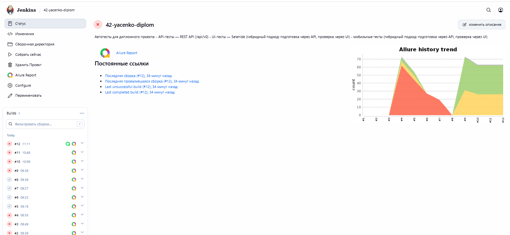
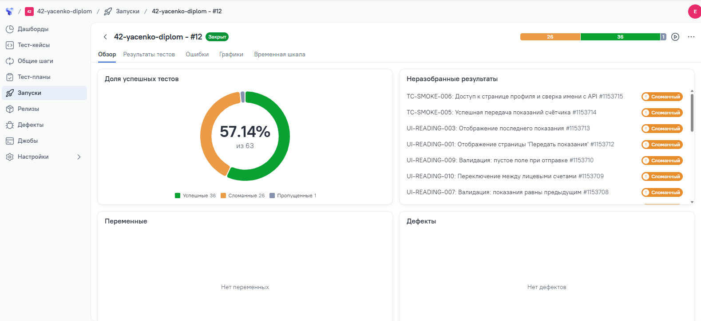
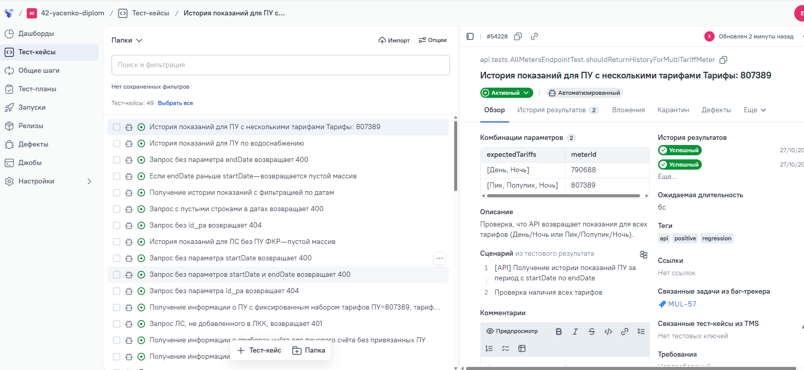
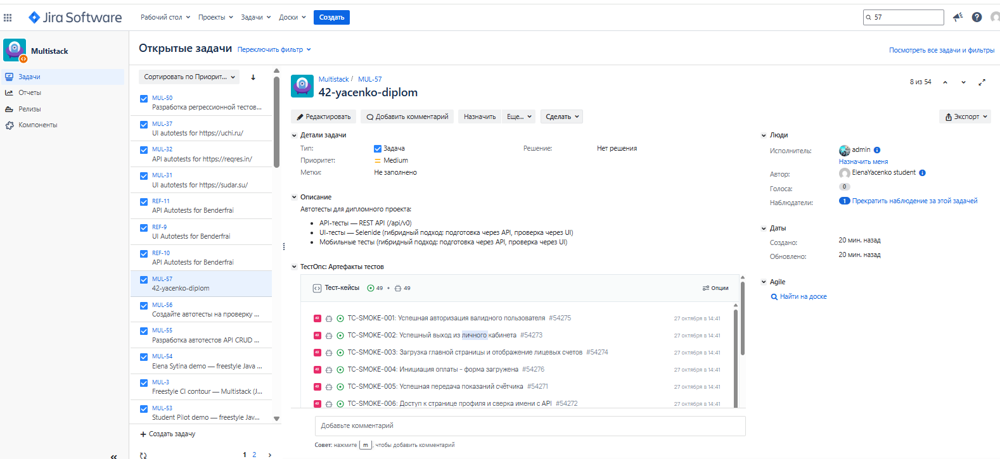
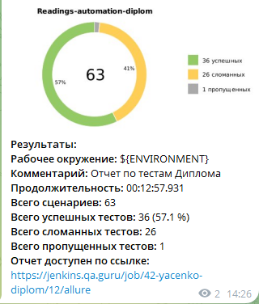

<div align="center">

# 🏢 CHSK LK Automation

</div>

> Дипломный проект: комплексный фреймворк автоматизации тестирования **Личного кабинета Чувашской энергосбытовой компании** (API + UI + Mobile + Manual).

<div align="center">

[](https://openjdk.org/)
[](https://gradle.org/)
[](https://selenide.org/)
[](https://appium.io/)
[](https://rest-assured.io/)
[](https://allurereport.org/)
[](https://www.jenkins.io/)
[](https://qameta.io/)
[](https://telegram.org/)
</div>
---

## 📑 Содержание

- [О проекте](#-о-проекте)
- [Технологический стек](#-технологический-стек)
- [Структура проекта](#-структура-проекта)
- [Быстрый старт](#-быстрый-старт)
- [Запуск тестов](#-запуск-тестов)
- [CI/CD и интеграции](#-cicd-и-интеграции)
   - [Jenkins: прогон API-тестов](#-jenkins-прогон-api-тестов)
   - [Allure TestOps](#-allure-testops)
   - [Jira](#-jira)
   - [Telegram](#-telegram)
- [Архитектура и подходы](#-архитектура-и-подходы)
- [Связанные README](#-связанные-readme)
- [Roadmap](#-roadmap)

---
<div align="center">

## 🏢 О проекте
</div>

Данный проект представляет собой **фреймворк автоматизации тестирования**, сфокусированный на конкретной бизнес-функции — **передаче показаний приборов учёта (ПУ)**.

В рамках дипломного проекта реализовано покрытие следующих уровней:

- **API-тесты** — проверка контрактов эндпоинтов, отвечающих за получение данных о приборах учёта и отправку новых показаний.
- **UI-тесты (веб)** — проверка страницы «Передать показания» в личном кабинете: отображение карточки ПУ, валидация полей ввода, успешная отправка данных.
- **Mobile-тесты (Android)** — частичное покрытие: авторизация, навигация на главный экран и проверка отображения страницы передачи показаний в мобильном приложении.
- **Manual-тесты** — уникальные сценарии для функции передачи показаний, которые сложно автоматизировать (UX при вводе с клавиатуры, сетевые сбои в момент отправки, поведение при смене прибора учёта).

**Цель проекта:** продемонстрировать навыки построения масштабируемого фреймворка с интеграцией в CI/CD (Jenkins), систему управления тестированием (Allure TestOps), трекер задач (Jira) и систему уведомлений (Telegram).

---

<div align="center">

## 🛠 Технологический стек
</div>

| Компонент | Технология | Версия                          |
| :--- | :--- |:--------------------------------|
| **Язык** | Java | 17                              |
| **Сборщик** | Gradle | 8.14.3                          |
| **API-тесты** | RestAssured + Jackson | 5.5.0                           |
| **UI-тесты** | Selenide + Selenium | 7.13.0 / 4.39.0                 |
| **Mobile-тесты** | Appium Java Client + UiAutomator2 | 10.0.0                          |
| **Отчетность** | Allure Framework | 2.29.0                          |
| **Конфигурация** | Aeonbits Owner | 1.0.12                          |
| **Тест-раннер** | JUnit 5 | 5.11.0                          |
| **Утилиты** | Lombok, DataFaker, AssertJ, Commons-IO | 9.2.0 / 2.5.4 / 3.27.7 / 2.16.1 |

---

<div align="center">

## 📂 Структура проекта
</div>

```text
src/test/java/
├── allure/             # Утилиты для Allure-вложений (Attach)
├── api/                # API-тесты
│   ├── apiClients/     # HTTP-клиенты (Auth, Devices, Meter и др.)
│   ├── models/         # DTO-модели (Records / Lombok)
│   ├── specs/          # Request/Response спецификации
│   └── tests/          # Тестовые классы API
├── base/               # Базовые классы (TestBase, TestBaseMob, TestData)
├── config/             # Owner-интерфейсы (TestConfig, MobileTestConfig) и Endpoints
├── extensions/         # Кастомные расширения (LoginExtension, ManualTestExtension, WithLogin)
├── manual/             # Ручные тесты (ManualTests)
├── mobile/             # Мобильные тесты
│   ├── drivers/        # AndroidDriverProvider
│   ├── screen/         # Page Object (LoginScreen, MainScreen, ReadingsScreen)
│   └── tests/          # Тестовые классы Mobile
├── ui/                 # UI-тесты
│   ├── components/     # Компоненты (Header, Sidebar)
│   ├── pages/          # Page Object страниц
│   └── tests/          # Тестовые классы UI
├── utils/              # AccountDataHelper и др.
└── notifications/      # Классы для отправки уведомлений (Telegram)

src/test/resources/
└── config/
    ├── default.properties
    ├── emulation.properties
    ├── browserstack.properties
    └── secret.properties (в .gitignore)
    
```
---

> Подробное описание каждого раздела см. в локальных README (ссылки ниже).

<div align="center">

## 🚀 Быстрый старт
</div>

### Предварительные требования

- **JDK 21**
- **Gradle 8.14.3**
- **Chrome** (для Web-тестов)
- **Android Emulator / Real Device** (для Mobile-тестов)
- **Appium Server** (для Mobile-тестов)

### Клонирование и сборка

```bash

git clone https://github.com/ElenaYacenko/backspark-lk-automation.git
cd backspark-lk-automation
./gradlew clean build -x test

```
### Настройка окружения

Для локального запуска тестов необходимо создать файл `src/test/resources/config/secret.properties` (он добавлен в `.gitignore` и не попадает в репозиторий).

Создайте файл по образцу `secret.properties.example` и заполните своими данными:

```properties
# Тестовый пользователь (для API и UI тестов)
testUser.phone=<номер_телефона>
testUser.password=<пароль>

# BrowserStack (для мобильных тестов)
browserstack.user=<ваш_логин>
browserstack.key=<ваш_ключ>
```

---

### 🧪 Запуск тестов

- По уровням
```bash
# API (эндпоинты ПУ и передачи показаний)
./gradlew test --tests "api.tests.*" -Denv=dev

# UI (веб-страница «Передать показания»)
./gradlew test --tests "ui.tests.*" -Dbrowser=chrome

# Mobile (Android)
./gradlew test --tests "mobile.tests.*" -DdeviceHost=emulation

# Manual (генерация чек-листа для ручного прохождения)
./gradlew test --tests "manual.*"

```
- С отчетом Allure
```bash
./gradlew test --tests "api.tests.*" && ./gradlew allureServe
```
<div align="center">

## 🎬 Демонстрация работы


</div>

---
<div align="center">

## 🔄 CI/CD и интеграции

### 🔧 [Jenkins: прогон API-тестов](https://jenkins.qa.guru/job/42-yacenko-diplom/)
Jenkins используется как CI-сервер для автоматического запуска API, UI и Mobile тестов. Сборка настроена как FreeStyle Project с двумя шагами Gradle: API+UI через Selenoid (headless Chrome) и Mobile через Android-эмулятор в Selenoid. Результаты собираются в Allure-отчет, уведомления уходят в Telegram.



### 📊 [Allure TestOps](https://allure.qa.guru/launch/56737)

Интеграция с Allure TestOps позволяет централизованно хранить результаты прогонов, отслеживать историю запусков и строить тренды стабильности тестов.




### 📋 [Jira](https://jira.qa.guru/projects/MUL/issues/MUL-57?filter=allopenissues)

Все тест-кейсы заведены в проект Multistack (MUL) и привязаны к задаче MUL-57. Каждый автотест имеет соответствующий тест-кейс в Jira, что обеспечивает трассируемость от требования до автотеста.



### 💬 Telegram

Автоматические уведомления в Telegram-канал после каждого завершения сборки: круговая диаграмма результатов, количество сценариев, продолжительность прогона и прямая ссылка на Allure-отчет.



## 🏗 Архитектура и подходы

</div>

- **Page Object + Components (UI):** вместо монолитных страниц используются переиспользуемые компоненты (Header, Sidebar), что упрощает поддержку страницы «Передать показания».
- **Слоистая архитектура (API):** apiClients → specs → models → tests. Тесты не работают с RestAssured напрямую.
- **Конфигурация через Owner:** никаких хардкодов. Все URL, логины и capabilities — в .properties.
- **Кастомные расширения JUnit 5:** @WithLogin (автоматическая авторизация через API), @Manual (для ручных тестов).
- **Универсальный Attach:** работает для Web, API и Mobile, автоматически определяет тип сессии.
- **Гибридный подход (UI + API):** данные для UI-проверок (номер ЛС, данные ПУ, последние показания) забираются через API (быстро и надежно).

<div align="center">

## 📚 Связанные README
</div>

> Проект разделен на четыре логические части, каждая из которых имеет свою документацию с описанием архитектуры, структуры и особенностей запуска.

| Раздел | Описание | Ссылка |
| :--- | :--- | :--- |
| 🔌 **API Tests** | Проверка контрактов эндпоинтов (приборы учета, передача показаний) | [`api/README.md`](src/test/java/api/README.md) |
| 🌐 **UI Tests** | Автотесты веб-версии личного кабинета (страница «Передать показания») | [`ui/README.md`](src/test/java/ui/README.md) |
| 📱 **Mobile Tests** | Автотесты Android-приложения (авторизация, главный экран, показания) | [`mobile/README.md`](src/test/java/mobile/README.md) |
| 📋 **Manual Tests** | Сценарии для ручного прохождения, которые сложно автоматизировать | [`manual/README.md`](src/test/java/manual/README.md) |