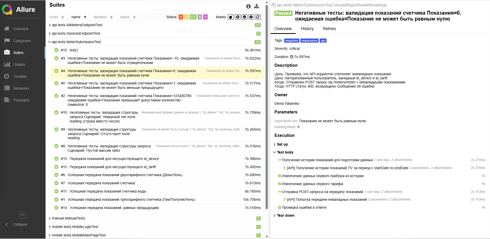

<div align="center">

# 🔌 API Tests

Автотесты для REST API **Личного кабинета Чувашской энергосбытовой компании**.

## 🛠 Стек

| Технология | Версия |
| :--- | :--- |
| Java | 21 |
| RestAssured | 5.5.0 |
| Allure | 2.29.0 |
| Jackson | 2.17.2 |
| Lombok | 9.2.0 |
| JUnit 5 | 5.11.0 |
| Gradle | 8.14.3 |

</div>

---
<div align="center">

## 📂 Структура

</div>

```bash
src/test/java/api/
 ├── apiClients/
 │   ├── ApiClient.java              # Базовый клиент (конфигурация RestAssured)
 │   ├── AuthApiClient.java          # Авторизация / получение токена
 │   ├── UserApiClient.java          # Работа с пользователями
 │   ├── UsersAccountApiClient.java  # Лицевые счета
 │   ├── DevicesApiClient.java       # Приборы учета
 │   ├── MeterApiClient.java         # Показания счетчиков
 │   └── AllMetersApiClient.java     # Все счетчики пользователя
 ├── models/
 │   ├── login/                      # Модели авторизации
 │   ├── userAccount/                # Модели лицевых счетов
 │   ├── userProfile/                # Модели профиля
 │   ├── devices/                    # Модели приборов учета
 │   ├── meter/                      # Модели показаний
 │   ├── allMeters/                  # Модели всех счетчиков
 │   └── localstorage/               # Вспомогательные модели
 ├── specs/
 │   ├── base/                       # Базовые спецификации (RequestSpec / ResponseSpec)
 │   ├── login/                      # Спецификации авторизации
 │   ├── users/                      # Спецификации пользователей
 │   ├── usersAccount/               # Спецификации ЛС
 │   ├── devices/                    # Спецификации устройств
 │   ├── meter/                      # Спецификации показаний
 │   └── allMeters/                  # Спецификации всех счетчиков
 └── tests/
    ├── AllMetersEndPointTest.java  # Тесты эндпоинта /allMeters
    ├── DevicesEndPointTest.java    # Тесты эндпоинта /devices
    └── MeterSubmissionTest.java    # Тесты передачи показаний
```
<div align="center">

## 🚀 Запуск

</div>

### Через IntelliJ IDEA
1. Открой нужный тестовый класс в `api/tests/`
2. Нажми ▶ рядом с классом или методом

### Через Gradle
```bash
# Все API-тесты
./gradlew test --tests "api.tests.*"

# Конкретный тест
./gradlew test --tests "api.tests.MeterSubmissionTest"

# С отчетом Allure
./gradlew test --tests "api.tests.*" && ./gradlew allureServe

```
<div align="center">

## ⚙️ Конфигурация окружений

</div>

API-тесты используют общую систему конфигурации проекта на базе библиотеки **Aeonbits Owner**.
Все настройки вынесены в `.properties` файлы и читаются через интерфейс `TestConfig` (и `MobileTestConfig` для мобильных тестов).

### Основные файлы конфигурации:
- **`default.properties`** — базовые настройки (например, URL стенда, базовый путь к API).
- **`secret.properties`** — чувствительные данные (логины, пароли, токены). Этот файл добавлен в `.gitignore` и не коммитится в репозиторий.

### Переключение окружений
Выбор окружения (например, `dev`, `test`, `prod`) осуществляется через системную переменную `env`. Библиотека Owner автоматически подхватит файл `classpath:config/${env}.properties`, если он существует.

Пример запуска тестов для конкретного стенда:
```bash
# Запуск с настройками для dev-окружения
./gradlew test -Denv=dev

# Запуск с настройками по умолчанию (из default.properties)
./gradlew test

```
<div align="center">

## 🏗 Архитектурные решения

</div>

Проект API-тестов построен по принципу разделения ответственности (Separation of Concerns). Каждый слой отвечает за свою задачу, что упрощает поддержку, масштабирование и повторное использование кода.

### 1. Слой клиентов (`apiClients`)
Этот слой инкапсулирует всю логику работы с HTTP-запросами. Тесты **никогда не вызывают** `RestAssured.given()` напрямую.
- **`ApiClient`** — базовый класс, который хранит настройки и агрегирует в себе другие клиенты (например, `api.auth.login()`).
- **`AuthApiClient`** — отвечает только за авторизацию и получение токена.
- **`DevicesApiClient`**, **`UsersAccountApiClient`** и др. — содержат методы для работы с конкретными эндпоинтами (GET, POST, PUT).
  *Преимущество:* Если изменится структура URL или заголовки, правки нужно будет внести только в одном месте — в клиенте.

### 2. Слой моделей (`models`)
Для десериализации JSON-ответов используются DTO (Data Transfer Objects).
- В проекте активно используются **Java Records** (для неизменяемых данных) и **Lombok** (аннотации `@Data`, `@Builder`), что избавляет от написания геттеров, сеттеров и конструкторов.
- Модели строго типизированы. Если API вернет неверный тип данных или отсутствующее поле, Jackson выбросит исключение при парсинге, и тест упадет с понятной ошибкой.

### 3. Слой спецификаций (`specs`)
Спецификации `RestAssured` (Request и Response) позволяют избежать дублирования настроек в каждом тесте.
- **`base/`** — содержит общие настройки (Base URI, Base Path, Content-Type, фильтры логирования для Allure).
- **`login/`**, **`meter/`** и др. — содержат специфичные настройки для конкретных групп эндпоинтов (например, проверка ожидаемого статус-кода 200 или 400).

### 4. Управление токенами
Для тестов, требующих авторизации, реализован механизм кэширования токена (в `AuthContext`). Это позволяет избежать выполнения лишних запросов на логин перед каждым тестом, что экономит время и снижает риск получения ошибки `429 Too Many Requests`.

---
<div align="center">

## 🧪 Покрытие тестами
</div>

На данный момент автоматизированы ключевые эндпоинты, отвечающие за получение данных лицевого счета и передачу показаний.

| Класс теста | Эндпоинт / Метод | Что проверяется | Приоритет |
| :--- | :--- | :--- | :--- |
| **`AllMetersEndPointTest`** | `/allMeters` | Получение списка всех счетчиков пользователя. Проверка корректности структуры ответа (JSON-схема) и наличия обязательных полей. | 🟠 CRITICAL |
| **`DevicesEndPointTest`** | `/devices` | Получение списка приборов учета (ПУ). Проверка, что возвращаются только активные устройства пользователя. | 🟠 CRITICAL |
| **`MeterSubmissionTest`** | `/meter` (POST) | Передача новых показаний. Проверка успешной отправки, а также обработка невалидных данных (граничные значения, отрицательные числа). | 🔴 BLOCKER |

**Типы проверок:**
- **Позитивные сценарии:** Проверка успешных ответов (200 OK) и соответствия данных бизнес-логике.
- **Негативные сценарии:** Проверка обработки ошибок (400 Bad Request, 401 Unauthorized) при передаче неверных данных или отсутствии токена.
- **Контрактные проверки:** Валидация структуры JSON-ответа (с использованием `json-schema-validator`).
<div align="center">

## 🔗 Связь с другими частями проекта
</div>

Данный раздел с API-тестами не является изолированным. Он тесно связан с остальными частями фреймворка — UI и Mobile тестами, которые используют его как фундамент для подготовки данных и проверки бизнес-логики.

- **UI-тесты (`ui.tests.*`)**
  Используют `ApiClient` и модели из данного раздела для быстрой подготовки тестовых данных (например, создание нового лицевого счета или прибора учета) до начала работы с веб-интерфейсом. Это позволяет обходить долгие UI-сценарии и делать тесты независимыми.

- **Mobile-тесты (`mobile.tests.*`)**
  Класс `AccountDataHelper` (используемый в мобильных тестах) напрямую обращается к `ApiClient` из этого раздела для получения актуальных данных лицевого счета (номер, данные ПУ, последние показания). Токен авторизации, полученный в API-слое, кэшируется в общем `AuthContext` и переиспользуется.

- **Ручные тесты (`manual.*`)**
  Бизнес-сценарии, которые пока не автоматизированы, но используют те же тестовые данные, что и API-тесты.

- **Общий README**
  Находится в корне проекта и описывает общую архитектуру всего фреймворка (API + UI + Mobile), правила запуска и настройки окружений.

<div align="center">

## 📸 Allure


</div>
