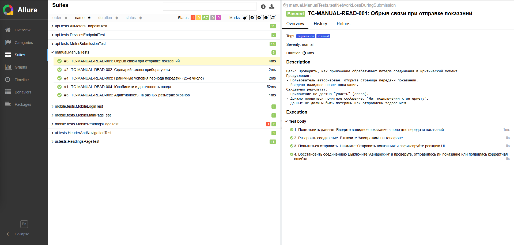

<div align="center">

# 📋 Ручные тесты (Manual Tests)


Этот раздел содержит сценарии ручного тестирования, разработанные для **дополнения** автоматизированных тестов проекта.
</div>

---
## 🎯 Зачем нужны ручные тесты, если есть автотесты?

Автотесты отлично проверяют стабильный функционал (happy path, валидацию полей, API-ответы). Однако некоторые сценарии сложно, дорого или невозможно покрыть автоматизацией. Эти ручные тесты фокусируются на:

- **UX/UI и доступности:** удобство нажатий, поведение при открытии клавиатуры.
- **Сетевых сбоях:** потеря соединения в момент отправки данных.
- **Сложных бизнес-сценариях:** например, смена прибора учета, требующая специфических данных в БД.
- **Граничных условиях времени:** смена даты устройства для проверки закрытия периода.
- **Адаптивности:** корректное отображение на разных размерах экранов.

---
<div align="center">

## 📂 Структура
</div>

Все ручные тесты находятся в пакете `manual` и используют кастомную аннотацию `@Manual`, которая интегрируется с Allure.

```text
src/test/java/manual/
├── ManualReadingsUniqueTests.java   # Уникальные ручные сценарии для страницы показаний
└── README.md                        # Этот файл

```
<div align="center">

## 🚀 Как выполнять ручные тесты
</div>

1. **Открой тест в IDE:** найди нужный метод в классе `ManualReadingsUniqueTests.java`.
2. **Запусти тест:** нажми зеленую кнопку ▶ (Run) рядом с методом (или всем классом).
   > Тест не будет управлять браузером или телефоном, но он сгенерирует подробный чек-лист в отчете Allure.
3. **Открой Allure:** выполни в терминале следующие команды:
   ```bash
   
   ./gradlew test --tests "manual.*"
   ./gradlew allureServe
   
   ```
4. **Выполняй шаги:** В открывшемся Allure-отчете переходи по шагам (Allure.step), выполняй действия на реальном устройстве или эмуляторе и фиксируй результат (Pass/Fail).

<div align="center">

## 📸 Allure

</div>


