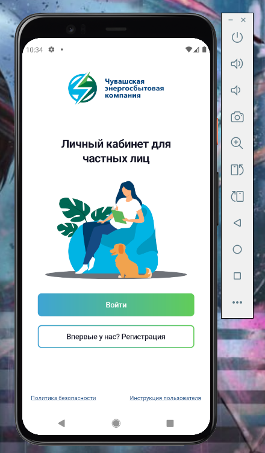
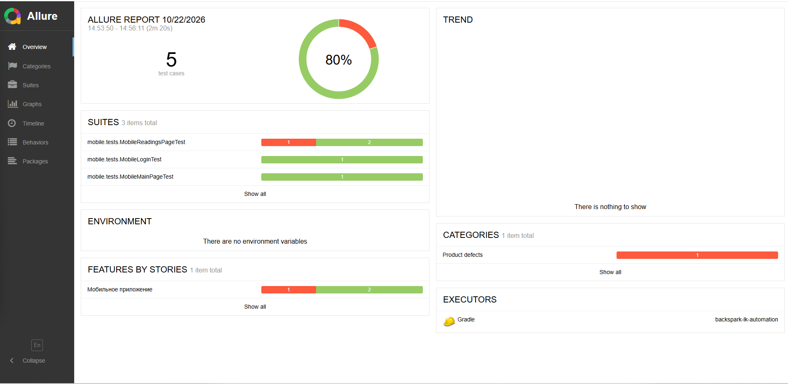
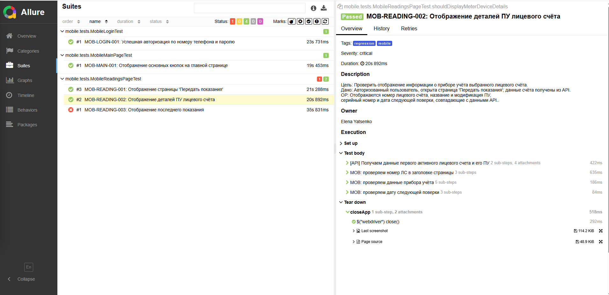

<div align="center">

# 📱 Mobile Automated Tests



</div>

> Автоматизированные тесты для мобильного приложения
> **Личный кабинет Чувашской энергосбытовой компании** (Android)

<div align="center">

[](https://openjdk.org/)
[](https://selenide.org/)
[](https://appium.io/)
[](https://allurereport.org/)
[](https://gradle.org/)

</div>

---

## 📑 Содержание

- [Технологический стек](#-технологический-стек)
- [Структура проекта](#-структура-проекта)
- [Быстрый старт](#-быстрый-старт)
- [Конфигурация окружений](#-конфигурация-окружений)
- [Запуск тестов](#-запуск-тестов)
- [Покрытие тестами](#-покрытие-тестами)
- [Архитектурные решения](#-архитектурные-решения)
- [Troubleshooting](#-troubleshooting)
- [Метрики](#-метрики)
- [Связь с другими частями проекта](#-связь-с-другими-частями-проекта)
- [Roadmap](#-roadmap)

---

## 🛠 Технологический стек

| Компонент | Технология | Версия |
|-----------|-----------|--------|
| **Язык программирования** | Java | 21 |
| **Фреймворк автоматизации** | Selenide + Appium Java Client | 7.13.0 + 10.0.0 |
| **Платформа** | Android | 11+ |
| **Движок автоматизации** | UiAutomator2 | latest |
| **Система отчетности** | Allure Framework | 2.29.0 |
| **Сборщик** | Gradle | 8.14.3 |
| **Конфигурация** | Aeonbits Owner | 1.0.12 |
| **Тест-раннер** | JUnit 5 | 5.11.0 |
| **API-клиент** | RestAssured | 5.5.0 |

---

## 📂 Структура проекта

```bash

 src/test/java/
 ├── allure/
 │   └── Attach.java                 # Утилита для Allure-вложений (скриншоты, видео, логи)
 ├── base/
 │   ├── TestBase.java               # База для веб/API тестов
 │   ├── TestBaseMob.java            # База для мобильных тестов (выбор драйвера, Attachments)
 │   └── TestData.java
 ├── config/
 │   ├── Endpoints.java
 │   ├── MobileTestConfig.java       # Owner-интерфейс для мобильных настроек
 │   ├── Pages.java
 │   └── TestConfig.java             # Owner-интерфейс для общих настроек (API, URL)
 ├── mobile/
 │   ├── drivers/
 │   │   └── AndroidDriverProvider.java  # Создание AndroidDriver (local/browserstack)
 │   ├── screen/
 │   │   ├── LoginScreen.java
 │   │   ├── MainScreen.java
 │   │   └── ReadingsScreen.java
 │   └── tests/
 │       ├── MobileLoginTest.java
 │       ├── MobileMainPageTest.java
 │       └── MobileReadingsPageTest.java
 ├── ui/                             # Веб-тесты
 ├── utils/
 │   └── AccountDataHelper.java      # Получение данных ЛС через API
 └── extensions/
    └── ManualTestListener.java

src/test/resources/
 └── config/
    ├── default.properties          # Базовые настройки
    ├── emulation.properties        # Локальный запуск (эмулятор)
    ├── browserstack.properties     # Удалённый запуск (BrowserStack)
    └── secret.properties           # Секреты (browserstack.user/key, тестовый юзер)
    
```

---

<div align="center">

## 🚀 Быстрый старт
</div>

---
### 📱 1. Подготовка APK-файла (Важно!)
Фреймворк настроен на **автоматическую установку** приложения. Вам не нужно устанавливать его вручную через ADB или эмулятор.

1. Убедитесь, что файл приложения находится в репозитории по пути:  
   `src/test/resources/apk/chsk.apk`
2. При запуске тестов `AndroidDriverProvider` автоматически найдет этот файл и передаст его абсолютный путь в capability `appium:app`. Благодаря этому Appium **сам установит** приложение на эмулятор перед началом тестов.

---

### 🛠 2. Подготовка окружения
```bash
# Запусти эмулятор в Android Studio
# Запусти Appium в отдельном терминале (Appium 2.x требует установки драйвера)
appium driver install uiautomator2
appium

# Проверь устройство
adb devices
```
### ⚙️ 3. Конфигурация
Основные настройки лежат в src/test/resources/config/. Пример для локального запуска (emulation.properties):
```bash
appiumUrl=http://127.0.0.1:4723/wd/hub
appPackage=ru.bokus.chskmobile
appActivity=ru.bokus.chskmobile.MainActivity
noReset=false
platformVersion=11
deviceName=Pixel_4
udid=emulator-5554
```
Важно: noReset=false обязателен для UI-тестов. Если поставить true, приложение запустится уже авторизованным, и тест логина упадет.
### ▶️ 4. Запуск тестов
```bash
# По умолчанию deviceHost=emulation, флаг можно не указывать
./gradlew test --tests "mobile.tests.*"

# Явное указание окружения
./gradlew test --tests "mobile.tests.*" -DdeviceHost=emulation
./gradlew test --tests "mobile.tests.*" -DdeviceHost=browserstack

# С отчетом Allure
./gradlew test --tests "mobile.tests.*" -DdeviceHost=emulation && ./gradlew allureServe
```

### 📹 Демонстрация работы

Автоматическая авторизация в мобильном приложении:


> **Примечание:** Видео демонстрирует успешный вход с использованием тестовых учетных данных.*

---
<div align="center">

## ⚙️ Конфигурация окружений
</div>

Проект использует библиотеку **Aeonbits Owner** для управления настройками. Конфигурация разделена на профили, что позволяет запускать тесты как локально, так и удаленно без изменения кода.

Выбор профиля осуществляется через системную переменную `env`, которая автоматически подставляется в путь к файлу: `classpath:config/${env}.properties`.

### Доступные профили:
- **`emulation.properties`** — локальный запуск на эмуляторе или реальном устройстве.
- **`browserstack.properties`** — удаленный запуск в облаке BrowserStack.
- **`default.properties`** — базовые настройки, которые применяются, если параметр не переопределен в профиле.
- **`secret.properties`** — содержит чувствительные данные (логины, пароли, ключи API) и добавлен в `.gitignore`.

<div align="center">

## 🧪 Покрытие тестами

</div>

На данный момент автоматизированы ключевые пользовательские сценарии: авторизация, проверка главного экрана и просмотр данных прибора учета.

| ID | Название теста | Класс | Приоритет | Теги |
| :--- | :--- | :--- | :--- | :--- |
| **MOB-LOGIN-001** | Успешная авторизация по номеру телефона и паролю | `MobileLoginTest` | 🔴 BLOCKER | `smoke`, `mobile` |
| **MOB-MAIN-001** | Отображение основных кнопок на главной странице | `MobileMainPageTest` | 🟠 CRITICAL | `regression`, `mobile` |
| **MOB-READING-001** | Отображение страницы «Передать показания» | `MobileReadingsPageTest` | 🟠 CRITICAL | `regression`, `mobile` |
| **MOB-READING-002** | Отображение деталей ПУ лицевого счёта | `MobileReadingsPageTest` | 🟠 CRITICAL | `regression`, `mobile` |
| **MOB-READING-003** | Отображение последнего переданного показания | `MobileReadingsPageTest` | 🟠 CRITICAL | `regression`, `mobile` |

**Типы проверок:**
- **UI/UX:** Проверка наличия и видимости элементов, корректность отображения данных.
- **Интеграция с API:** Сверка данных, отображаемых на экране (номер ЛС, данные ПУ, показания), с ответами реального API (используется `AccountDataHelper`).
<div align="center">

## 🏗 Архитектурные решения

</div>

Проект построен с использованием паттерна **Page Object** и принципов **DRY** (Don't Repeat Yourself), что обеспечивает легкость поддержки и масштабирования тестов.

### 1. Паттерн Page Object (Page Objects & Screens)
Вместо того чтобы писать локаторы и клики прямо в тестах, каждый экран приложения инкапсулирован в отдельный класс в пакете `mobile.screen`:
- `LoginScreen` — работа с экраном авторизации.
- `MainScreen` — работа с главным экраном.
- `ReadingsScreen` — работа с экраном передачи показаний.
  *Тесты оперируют бизнес-методами (например, `loginScreen.enterLogin()`), что делает код тестов читаемым даже для нетехнических специалистов.*

### 2. Базовый класс `TestBaseMob`
Вся рутинная логика подготовки и завершения тестов вынесена в базовый класс:
- **`@BeforeAll`** — инициализация конфигурации, выбор драйвера (`AndroidDriverProvider`) в зависимости от окружения (эмулятор или BrowserStack), настройка `RestAssured`.
- **`@BeforeEach`** — добавление слушателя `AllureSelenide` для логирования шагов Selenide и открытие приложения.
- **`@AfterEach`** — сбор артефактов (Attachments) и закрытие сессии.

### 3. Конфигурация через Aeonbits Owner
Никаких захардкоженных путей или данных в коде. Все настройки вынесены в `.properties` файлы и читаются через интерфейсы `MobileTestConfig` и `TestConfig`.
- **Профили окружений:** `emulation.properties` (локально) и `browserstack.properties` (удаленно).
- **Секреты:** логины, пароли и ключи BrowserStack вынесены в `secret.properties` (в `.gitignore`).
- **Капабилити драйвера:** данные устройства, версия OS, имя проекта и билда для BrowserStack берутся из конфига.

### 4. Универсальный сбор вложений в Allure
Утилита `allure.Attach` умеет работать в трех режимах (Web, API, Mobile). В методе `@AfterEach` (в `TestBaseMob`) происходит автоматический сбор:
- **Скриншот** последнего экрана (при падении или успехе).
- **Page Source (XML)** для разбора UI-дерева.
- **Ссылка на сессию BrowserStack** (для удаленного запуска) или **видео** (для Selenoid).
- Все обернуто в блок `try/catch/finally`, чтобы падение при сборе артефактов не маскировало реальную ошибку теста.

### 5. Гибридный подход (UI + API)

Для проверки отображения данных (например, показаний приборов учета) используется гибридный подход. Вместо того чтобы "пробивать" все данные через интерфейс (что долго и нестабильно), тест забирает эталонные данные напрямую из API и сравнивает их с тем, что видит пользователь на экране.

**Как это работает:**
1. **Подготовка данных (API):** Утилита `AccountDataHelper` (используя `RestAssured` и `ApiClient`) делает запросы к бэкенду, авторизуется и получает актуальные данные первого активного лицевого счета (номер ЛС, название ПУ, серийный номер, дату поверки, последние показания).
2. **Проверка данных (UI):** Полученные данные передаются в методы проверок Page Object (например, `readingsScreen.verifyMeterDeviceTitleDisplayed(...)`), которые проверяют, что эти же значения корректно отображаются на экране мобильного приложения.

**Преимущества:**
- **Скорость:** Не нужно проходить долгие UI-сценарии для подготовки состояния.
- **Стабильность:** Исключены ложные падения, если данные были изменены в другом месте или время передачи показаний еще не наступило.
- **Независимость:** Тест проверяет именно отображение данных, а не работу бэкенда (за это отвечают API-тесты).

---

<div align="center">

## 🔗 Связь с другими частями проекта

</div>

- API-тесты — AccountDataHelper использует ApiClient для получения данных лицевого счёта (номер, ПУ, показания). Токен авторизации — общий (AuthContext).
- UI-тесты — отдельный TestBase для веб-интерфейса. Локаторы и Page Object не пересекаются с мобильными.
- Общий README — в корне проекта, описывает все 3 части и общую структуру.
- Attach — общая утилита для веб, API и мобильных тестов (универсальная, определяет тип сессии).

<div align="center">

## 📸 Allure

</div>


