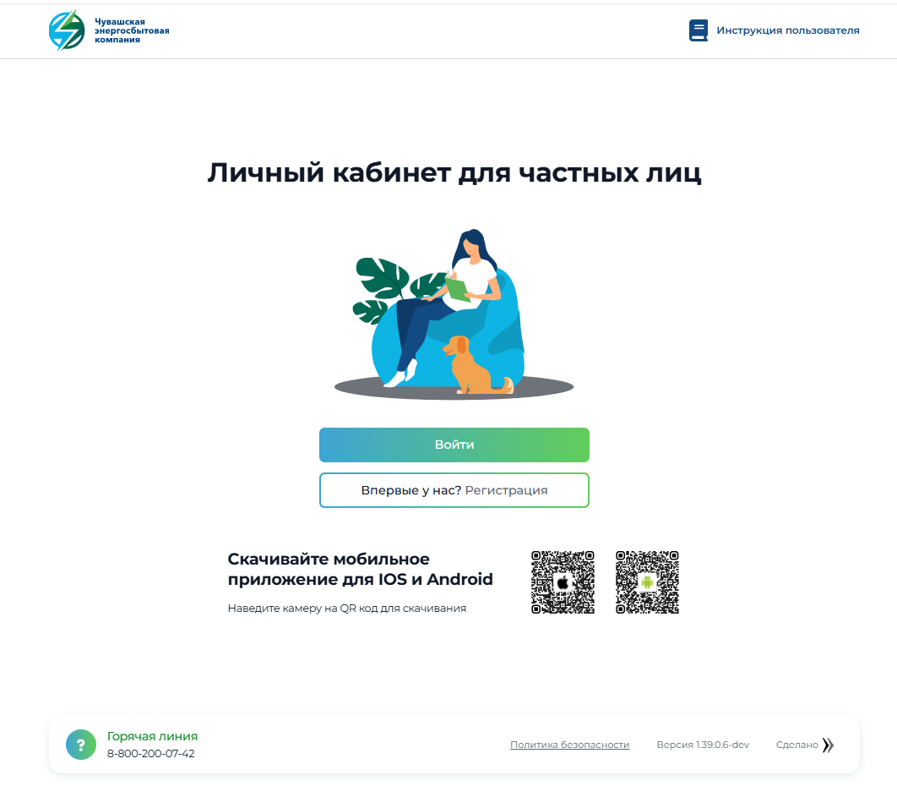
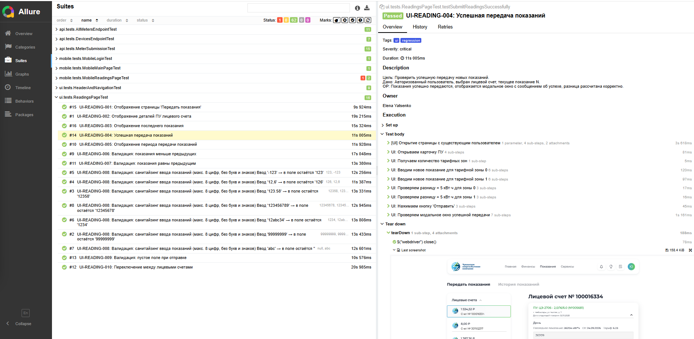

<div align="center">

# 🌐 UI Tests



Автотесты для веб-версии **Личного кабинета Чувашской энергосбытовой компании**.

</div>

---

## 🛠 Стек

| Технология | Версия |
| :--- |:-------|
| Java | 21     |
| Selenide | 7.13.0 |
| Selenium | 4.27.0 |
| Allure | 2.29.0 |
| JUnit 5 | 5.11.0 |
| Gradle | 8.14.3 |

---
<div align="center">

## 📂 Структура

</div>

```bash
src/test/java/ui/
├── README.md
├── components/
│   ├── AccountsSidebarComponent.java        # Сайдбар с лицевыми счетами
│   ├── AddAccountModalComponent.java        # Модалка добавления ЛС
│   ├── HeaderComponent.java                 # Шапка сайта
│   └── UnifiedAccountsSidebarComponent.java # Унифицированный сайдбар
├── pages/
│   ├── BasePage.java                        # Базовая страница
│   ├── LoginPage.java                       # Страница авторизации
│   ├── MainPage.java                        # Главная страница
│   ├── ModalDialog.java                     # Модальные окна
│   ├── PaymentPage.java                     # Страница оплаты
│   ├── ProfilePage.java                     # Профиль пользователя
│   └── ReadingsPage.java                    # Страница показаний
└── tests/
    ├── HeaderAndNavigationTest.java         # Тесты навигации и шапки
    ├── ReadingsPageTest.java                # Тесты страницы показаний
    └── WebSmokeTest.java                    # Дымовые тесты
    
```
<div align="center">

## 🚀 Запуск
</div>

### Через IntelliJ IDEA
1. Открой нужный тестовый класс в ui.tests.*.
2. Нажми зеленую стрелку ▶ рядом с классом или методом
3. (Опционально) Укажи браузер в VM options: `-Dbrowser=chrome`

### Через Gradle

```bash
# Все UI-тесты
./gradlew test --tests "ui.tests.*"

# Конкретный тест
./gradlew test --tests "ui.tests.ReadingsPageTest"

# С отчетом Allure
./gradlew test --tests "ui.tests.*" && ./gradlew allureServe

```
<div align="center">

## 🏗 Архитектура
</div>

### Компонентный подход
Вместо классического Page Object используется компонентная архитектура:
- components/ — переиспользуемые UI-блоки (шапка, сайдбар)
- pages/ — страницы, которые используют компоненты

## Кастомная аннотация @WithLogin

Для избавления от дублирования кода авторизации используется кастомная аннотация, которая автоматически выполняет вход через API перед запуском теста:

```java
@Test
@WithLogin  // ← Автоматически выполняет вход через API
void testSomething() {
    // Тест уже авторизован
}
```
## Интеграция с API
UI-тесты активно используют API для подготовки данных. Это позволяет делать тесты быстрее и независимыми от состояния базы данных. Например, получение ID лицевого счета для проверки отображения на экране:

```java
// Получение тестовых данных через API
AccountDataHelper.ActiveAccountData data = 
    accountDataHelper.getFirstActiveAccountData();
```
<div align="center">

## 🔗 Связь с проектом
</div>

- Mobile-тесты: mobile.tests.* — аналогичные сценарии для мобильного приложения.
- API-тесты: api.tests.* — проверка эндпоинтов, данные из которых используются в UI-тестах.
- Ручные тесты: manual.* — бизнес-сценарии, требующие участия человека.

<div align="center">

## 📸 Allure

</div>


